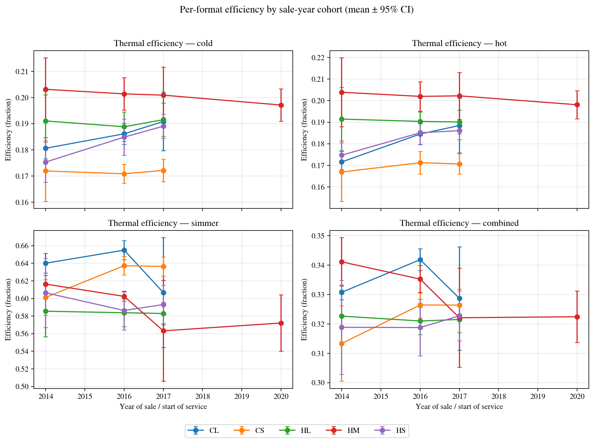

# Phase 4: Years in Service and Cohort Analysis

**Years in service** = `campaign_year − sale_year`. `sale_year` is parsed from Toyola HxC filenames (`HS2014N1.xlsx` → 2014). `campaign_year` is parsed from the campaign folder name (`Rapport Toyola 2018` → 2018). Both available for the Toyola HxC subset of the dataset.

## 1. Can WBT data + geometry predict years in service?

Random Forest and Ridge, grouped 5-fold CV by stove identity. MAE is in years.
If MAE is close to the standard deviation of `years_in_service`, the model is essentially predicting the dataset mean — it has no real signal.

| Model | n_total | MAE (years, mean ± std) | R² (mean ± std) |
|---|---:|---|---|
| rf | 405 | 0.690 ± 0.061 | +0.610 ± 0.092 |
| ridge | 405 | 1.169 ± 0.060 | +0.114 ± 0.086 |

## 2. Per-cohort efficiency table

Mean ± 95% CI per (format × sale_year) for each efficiency phase. See `cohort_stats.csv` for the full table; below is the combined-efficiency subset.

| Format | Sale year | n | Mean | 95% CI |
|---|---:|---:|---:|---|
| CL | 2014 | 12 | 0.3308 | [0.3283, 0.3333] |
| CL | 2016 | 28 | 0.3419 | [0.3382, 0.3456] |
| CL | 2017 | 30 | 0.3287 | [0.3111, 0.3463] |
| CL | 2020 | 2 | 0.1819 | [-0.6564, 1.0202] |
| CL | 2021 | 2 | 0.1852 | [-0.6392, 1.0095] |
| CS | 2014 | 12 | 0.3134 | [0.3005, 0.3262] |
| CS | 2016 | 28 | 0.3265 | [0.3220, 0.3309] |
| CS | 2017 | 28 | 0.3264 | [0.3210, 0.3318] |
| CS | 2018 | 2 | 0.1775 | [-0.5945, 0.9494] |
| CS | 2020 | 2 | 0.1805 | [-0.6380, 0.9990] |
| HL | 2014 | 12 | 0.3227 | [0.3138, 0.3315] |
| HL | 2016 | 28 | 0.3210 | [0.3164, 0.3256] |
| HL | 2017 | 28 | 0.3215 | [0.3170, 0.3260] |
| HL | 2018 | 2 | 0.1735 | [-0.5202, 0.8671] |
| HL | 2019 | 2 | 0.1816 | [-0.6082, 0.9715] |
| HL | 2022 | 2 | 0.1865 | [-0.6382, 1.0112] |
| HM | 2014 | 12 | 0.3411 | [0.3329, 0.3494] |
| HM | 2016 | 28 | 0.3352 | [0.3306, 0.3399] |
| HM | 2017 | 30 | 0.3221 | [0.3053, 0.3390] |
| HM | 2020 | 52 | 0.3225 | [0.3137, 0.3312] |
| HM | 2022 | 2 | 0.1837 | [-0.6293, 0.9967] |
| HS | 2014 | 12 | 0.3189 | [0.3029, 0.3348] |
| HS | 2016 | 28 | 0.3188 | [0.3091, 0.3284] |
| HS | 2017 | 28 | 0.3227 | [0.3143, 0.3312] |
| HS | 2019 | 2 | 0.1761 | [-0.5371, 0.8893] |
| HS | 2020 | 2 | 0.1787 | [-0.5794, 0.9368] |
| HS | 2021 | 2 | 0.1801 | [-0.5953, 0.9555] |
| HS | 2022 | 2 | 0.1823 | [-0.6224, 0.9870] |

## 3. Visualization

